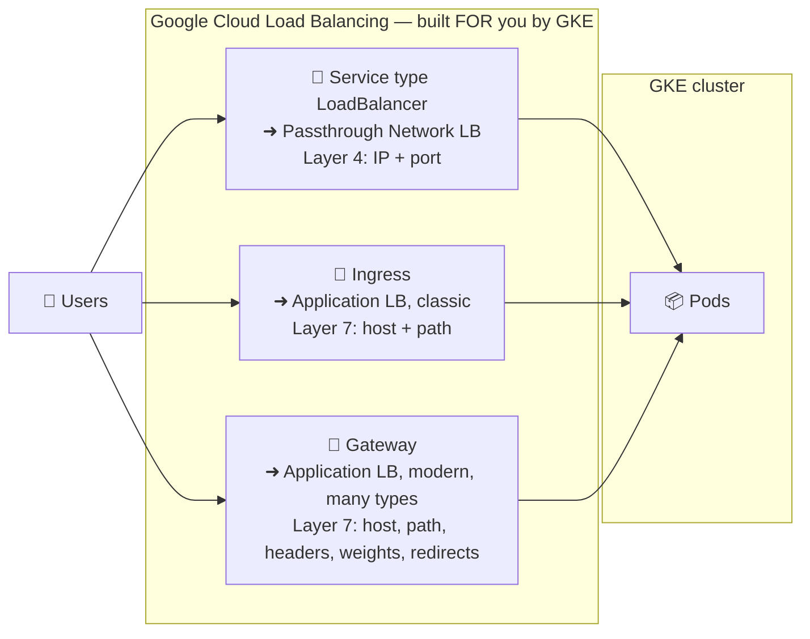
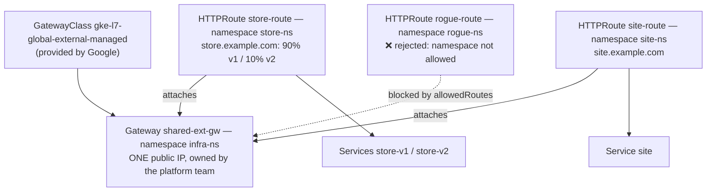
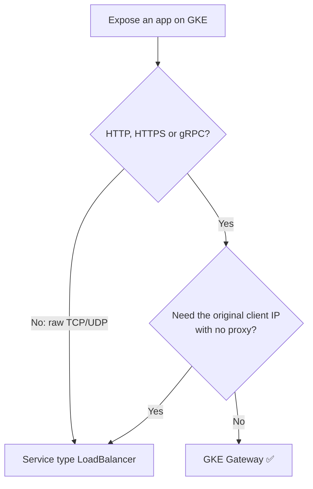

# `gke-gateway-study-01` — GKE Gateway Study Repository

A beginner-friendly study kit for **GKE Gateway** (the Kubernetes **Gateway API** on Google Kubernetes Engine), written for people who know **networking and Google Cloud Load Balancing** but only a little Kubernetes.

It answers three questions, with diagrams:

1. **What is GKE Gateway?**
2. **How is it different from GKE Ingress and from a Service of type LoadBalancer?**
3. **Why (and when) should I choose GKE Gateway over the alternatives?**

| Start here | What you get |
| :--- | :--- |
| 📘 [`study-notes.md`](./study-notes.md) | The full concept guide: Kubernetes primer, the three "doors", Gateway API objects mapped to Cloud Load Balancing, GatewayClasses, routing, policies, TLS, multi-cluster, comparison, decision guide, migration, troubleshooting. |
| 🧪 [`hands-on-lab.md`](./hands-on-lab.md) | A Console-first lab: same app behind 3 doors, a shared multi-team Gateway with a 90/10 canary, Cloud Armor via policies, and an internal Gateway. |
| 📂 [`manifests/`](./manifests) | Commented YAML for every lab step. |
| 🛠️ [`scripts/`](./scripts) | CLI fallbacks: create infra, deploy, verify, clean up. |

---

## 1. GKE Gateway in 60 seconds

- In Kubernetes, your app runs in **Pods**. Pods have private, changing IPs, so users need a **stable front door** that load balances to healthy Pods.
- On GKE you describe that front door in YAML, and a **Google-managed controller builds a real Cloud Load Balancer** for you.
- The **Gateway API** is the **new official Kubernetes standard** for that front door (successor of Ingress). **GKE Gateway** is **Google's implementation**: it turns Gateway API objects into Cloud Load Balancing — no software to install in your cluster.
- It splits the front door into pieces owned by different people:

| Gateway API object | Simple meaning | Who owns it | Cloud Load Balancing piece |
| :--- | :--- | :--- | :--- |
| `GatewayClass` | *Which kind of load balancer?* | Google (built in) | LB type, e.g. global external Application LB |
| `Gateway` | *The front door*: IP, ports, TLS, who may use it | Platform / network team | Forwarding rule + target proxy |
| `HTTPRoute` | *Where traffic goes*: host, path, headers, weights | App teams | URL map rules |
| `Service` | *Which Pods* | App teams | Backend service + NEGs (Pod IPs) |
| Policies | *Extra features*: health check, Cloud Armor, IAP, SSL policy | Platform / app teams | Health check, backend & frontend settings |

## 2. The big picture — three doors into a GKE cluster



And how one shared Gateway serves many teams:



## 3. Quick comparison

| | Service type `LoadBalancer` | GKE Ingress | GKE Gateway |
| :--- | :--- | :--- | :--- |
| Layer | L4 | L7 | L7 |
| Google Cloud LB (external) | Passthrough Network LB (regional) | **Classic** Application LB | **You choose**: global external Application LB (`EXTERNAL_MANAGED`), regional external, regional internal, classic |
| IPs | One per Service | One per Ingress | **One per Gateway, shared** by many teams |
| Routing | IP + port only | Host + path | Host, path, **header, query, method, weights, redirects, rewrites, header changes** |
| Canary by % | ❌ | ❌ | ✅ |
| Cloud Armor / IAP | ❌ | ✅ `BackendConfig` | ✅ `GCPBackendPolicy` |
| Team separation | ❌ | ❌ | ✅ |
| Cross-namespace | n/a | ❌ | ✅ |
| Kubernetes API status | Core | **Frozen** (no new features) | **Actively developed** |

Full table: [study-notes.md — Part 6](./study-notes.md#part-6--side-by-side-comparison).

## 4. Why choose GKE Gateway?

1. **One front door, many apps and teams** — fewer load balancers, IPs and certificates.
2. **Safe self-service** — platform team owns the Gateway, app teams own routes; rogue routes are rejected.
3. **Rich routing built into the standard** — canary weights, header matching, redirects, rewrites: no annotations.
4. **Modern Google Cloud load balancers** — global external Application LB (`EXTERNAL_MANAGED`), regional external and internal; external GKE Ingress is limited to the classic LB.
5. **Typed policies with clear status** — Cloud Armor, IAP, health checks, SSL policies as validated objects.
6. **Portable and future-proof** — the Ingress API is frozen, the community ingress-nginx controller was retired in March 2026, and new GKE features (Inference Gateway, Service Extensions, multi-cluster) build on Gateway.

**Use a Service type LoadBalancer instead** when the protocol is not HTTP (raw TCP/UDP) or the app must see the original client IP with no proxy in between.
**Keep Ingress for now** only if it works well and you have not yet checked feature parity — then plan the migration ([Part 8](./study-notes.md#part-8--moving-from-ingress-to-gateway)).



## 5. Suggested learning path

| Step | Read / do | Time |
| :--- | :--- | :--- |
| 1 | [Part 1 — Just enough Kubernetes](./study-notes.md#part-1--just-enough-kubernetes-10-minute-primer) and [Part 2 — the three doors](./study-notes.md#part-2--the-question-how-does-outside-traffic-reach-my-pods) | 15 min |
| 2 | [Parts 3–4 — LoadBalancer Service and Ingress](./study-notes.md#part-3--door-1-service-type-loadbalancer-layer-4) | 15 min |
| 3 | [Part 5 — Gateway API and GKE Gateway](./study-notes.md#part-5--door-3-gateway-api-and-gke-gateway-layer-7-the-modern-way) (the core) | 30 min |
| 4 | [Lab 0 + Lab 1 — three doors](./hands-on-lab.md#lab-1--one-app-three-doors) | 35 min |
| 5 | [Lab 2 — shared Gateway](./hands-on-lab.md#lab-2--one-shared-gateway-many-teams), [Lab 3 — policies](./hands-on-lab.md#lab-3--policies-health-check-cloud-armor-logging), [Lab 4 — internal Gateway](./hands-on-lab.md#lab-4--internal-gateway-same-api-different-load-balancer) | 55 min |
| 6 | [Parts 6–9 — comparison, decision guide, migration, troubleshooting](./study-notes.md#part-6--side-by-side-comparison) | 20 min |

## 6. Repository structure

```text
gke-gateway-study-01/
├── README.md                          # This page: the 60-second answer, big picture, comparison
├── study-notes.md                     # Full concept guide with diagrams (Parts 1-10)
├── hands-on-lab.md                    # Console-first lab guide (Labs 0-5)
├── manifests/
│   ├── lab1-three-doors/              # Same app behind LoadBalancer Service, Ingress and Gateway
│   ├── lab2-shared-gateway/           # Shared Gateway, 2 teams, canary 90/10, redirect, rogue route
│   ├── lab3-policies/                 # HealthCheckPolicy + GCPBackendPolicy (Cloud Armor, logging, timeout)
│   └── lab4-internal-gateway/         # gke-l7-rilb Gateway + GCPGatewayPolicy (global access)
├── scripts/
│   ├── env.sh                         # All names, regions and IP ranges in one place
│   ├── 00-create-infra.sh             # VPC, subnets, Autopilot cluster (CLI fallback for Lab 0)
│   ├── 10-deploy-lab.sh               # Deploy lab1|lab2|lab3|lab4|all and wait for load balancers
│   ├── 20-verify-lab.sh               # Run the curl tests for each lab
│   └── 99-cleanup.sh                  # Safe clean-up order (asks before each delete)
└── logs/
    └── lab0-cluster-gatewayclasses.txt  # Real output: GatewayClasses + CRDs installed by GKE 1.36
```

## 7. Lab environment

| Item | Value |
| :--- | :--- |
| Project / region | `gcp-demo-02-307713` / `asia-southeast2` (Jakarta) |
| VPC / subnets | `gke-gw-study-vpc`: `gke-gw-study-subnet` `10.20.0.0/24` (Pods `10.21.0.0/17`, Services `10.22.0.0/22`), proxy-only `10.20.2.0/23` |
| Cluster | `gke-gw-study-cluster` — GKE **Autopilot**, Regular channel, `1.36.4-gke.2377000` |
| Status (2026-11-16) | Lab 0 created. Lab 1 partly applied (app, Door 1, Door 2). Labs 1 (Door 3) to 4 are ready for you to run — see [hands-on-lab.md](./hands-on-lab.md). |

> [!WARNING]
> The cluster and the load balancers cost money while they exist. When you finish, follow
> [Lab 5 — Clean up](./hands-on-lab.md#lab-5--clean-up) (Console steps) or run `./scripts/99-cleanup.sh`.

## 8. Key references

- [About the Gateway API on GKE](https://cloud.google.com/kubernetes-engine/docs/concepts/gateway-api)
- [Deploying Gateways](https://cloud.google.com/kubernetes-engine/docs/how-to/deploying-gateways)
- [GatewayClass capabilities](https://cloud.google.com/kubernetes-engine/docs/how-to/gatewayclass-capabilities)
- [Migrate Ingress to Gateway API](https://cloud.google.com/kubernetes-engine/docs/how-to/migrate-ingress-gateway)
- [Gateway API project (Kubernetes SIG-Network)](https://gateway-api.sigs.k8s.io/)

More in [study-notes.md — References](./study-notes.md#references).
