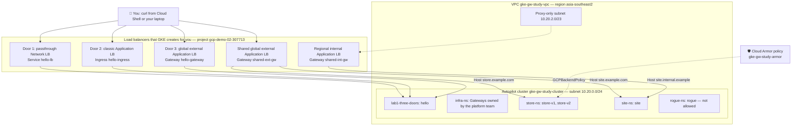
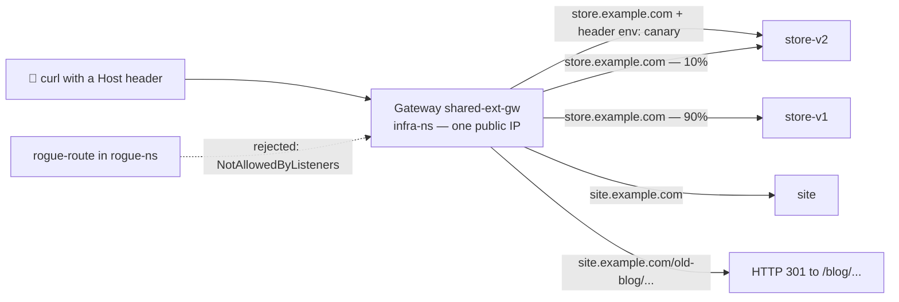

# Hands-on Lab — GKE Gateway vs Ingress vs Service type LoadBalancer

> Read [`study-notes.md`](./study-notes.md) Parts 1–5 first (or at least the Big Picture in the [README](./README.md)).
> This lab is **Console-first**: use the Google Cloud Console when it can do the job, and Cloud Shell (`kubectl` / `gcloud`) when it cannot.
> The Console has **no "apply YAML" button** and **no create wizard for Gateways or HTTPRoutes**, so Kubernetes objects are applied from **Cloud Shell**.

| Lab | What you learn | Time |
| :--- | :--- | :--- |
| [Lab 0](#lab-0--environment-vpc-subnets-and-an-autopilot-cluster) | Build the VPC, subnets and an Autopilot cluster | 15 min |
| [Lab 1](#lab-1--one-app-three-doors) | Same app behind **3 doors** — see what Google Cloud builds for each | 20 min |
| [Lab 2](#lab-2--one-shared-gateway-many-teams) | **Shared Gateway**, role separation, host/header routing, **canary 90/10**, redirects, guardrails | 25 min |
| [Lab 3](#lab-3--policies-health-check-cloud-armor-logging) | **Policies**: HealthCheckPolicy and GCPBackendPolicy with **Cloud Armor** | 15 min |
| [Lab 4](#lab-4--internal-gateway-same-api-different-load-balancer) | **Internal Gateway** (`gke-l7-rilb`) + `GCPGatewayPolicy` global access | 15 min |
| [Lab 5](#lab-5--clean-up) | Clean up in the right order | 10 min |

> [!IMPORTANT]
> **Status of the shared environment in `gcp-demo-02-307713` (2026-11-16):**
> Lab 0 is **done** (VPC, both subnets and the Autopilot cluster exist), and Lab 1 steps 1.1–1.2 were **partly applied**
> (namespace, `hello` app, Door 1 `hello-lb` and Door 2 `hello-ingress`; Door 3 was **not** applied yet).
> If you continue in that environment, start at [Lab 0 — step 0.4](#04-connect-from-cloud-shell). All `kubectl apply` commands are safe to re-run.

---

## Lab architecture



All settings live in [`scripts/env.sh`](./scripts/env.sh):

| Setting | Value |
| :--- | :--- |
| Project / region | `gcp-demo-02-307713` / `asia-southeast2` (Jakarta) |
| VPC | `gke-gw-study-vpc` (custom mode) |
| Node subnet | `gke-gw-study-subnet` `10.20.0.0/24`, secondary ranges `gke-gw-study-pods` `10.21.0.0/17` and `gke-gw-study-services` `10.22.0.0/22`, Private Google Access on |
| Proxy-only subnet | `gke-gw-study-proxy-only-subnet` `10.20.2.0/23` (purpose `REGIONAL_MANAGED_PROXY`, role `ACTIVE`) |
| Cluster | `gke-gw-study-cluster`, **Autopilot**, Regular channel (`1.36.4-gke.2377000` at creation) |
| Test app | [`whereami`](https://github.com/GoogleCloudPlatform/kubernetes-engine-samples/tree/main/quickstarts/whereami) — answers with JSON about the Pod that served you; `GET /metadata` returns just the app label |

---

## Lab 0 — Environment: VPC, subnets and an Autopilot cluster

### 0.1 Create the VPC and the node subnet

**Console (recommended):** **VPC network → VPC networks → Create VPC network**

1. **Name:** `gke-gw-study-vpc`
2. **Subnet creation mode:** **Custom**. In **New subnet**:
   - **Name:** `gke-gw-study-subnet`, **Region:** `asia-southeast2`, **IPv4 range:** `10.20.0.0/24`
   - Add two **secondary IPv4 ranges**:
     `gke-gw-study-pods` = `10.21.0.0/17` and `gke-gw-study-services` = `10.22.0.0/22`
   - **Private Google Access:** **On**
3. **Dynamic routing mode:** **Regional** → **Create**.

<details>
<summary>gcloud alternative</summary>

```bash
source scripts/env.sh
gcloud compute networks create "$VPC_NAME" --subnet-mode=custom --bgp-routing-mode=regional --project="$PROJECT_ID"
gcloud compute networks subnets create "$SUBNET_NAME" --network="$VPC_NAME" --region="$REGION" \
  --range="$SUBNET_RANGE" \
  --secondary-range="${POD_RANGE_NAME}=${POD_RANGE},${SVC_RANGE_NAME}=${SVC_RANGE}" \
  --enable-private-ip-google-access --project="$PROJECT_ID"
```
</details>

### 0.2 Create the proxy-only subnet (needed by regional and internal Gateways)

Regional Application Load Balancers (`gke-l7-rilb`, `gke-l7-regional-external-managed`) run **Envoy proxies inside your VPC**. Those proxies take their IPs from a **proxy-only subnet**. Create it **before** any regional/internal Gateway.

**Console:** **VPC network → VPC networks → `gke-gw-study-vpc` → Subnets → Add subnet**

- **Name:** `gke-gw-study-proxy-only-subnet`, **Region:** `asia-southeast2`
- **Purpose:** **Regional Managed Proxy**, **Role:** **Active**
- **IPv4 range:** `10.20.2.0/23` → **Add**

<details>
<summary>gcloud alternative</summary>

```bash
gcloud compute networks subnets create "$PROXY_SUBNET_NAME" --network="$VPC_NAME" --region="$REGION" \
  --range="$PROXY_SUBNET_RANGE" --purpose=REGIONAL_MANAGED_PROXY --role=ACTIVE --project="$PROJECT_ID"
```
</details>

### 0.3 Create the Autopilot cluster

**Console:** **Kubernetes Engine → Clusters → Create** → choose **Autopilot**

1. **Cluster basics:** **Name** `gke-gw-study-cluster`, **Region** `asia-southeast2`, **Release channel** `Regular`.
2. **Networking:** **Network** `gke-gw-study-vpc`, **Node subnet** `gke-gw-study-subnet`.
   For **Pods** and **Services**, choose **Use existing range** → `gke-gw-study-pods` and `gke-gw-study-services`.
3. **Create**. It takes about 5–10 minutes.

> [!NOTE]
> **Gateway API is always on in Autopilot** — there is no checkbox. On a **Standard** cluster you would tick
> **Networking → Load Balancer, Ingress, and Gateway → Enable Gateway API** (or use `--gateway-api=standard`).

<details>
<summary>gcloud alternative</summary>

```bash
gcloud container clusters create-auto "$CLUSTER_NAME" --region="$REGION" \
  --network="$VPC_NAME" --subnetwork="$SUBNET_NAME" \
  --cluster-secondary-range-name="$POD_RANGE_NAME" --services-secondary-range-name="$SVC_RANGE_NAME" \
  --release-channel=regular --project="$PROJECT_ID"
```

Or run everything in Lab 0 with one script: `./scripts/00-create-infra.sh`.
</details>

### 0.4 Connect from Cloud Shell

**Console:** **Kubernetes Engine → Clusters → `gke-gw-study-cluster` → Connect → Run in Cloud Shell**, press Enter. Then:

```bash
git clone https://github.com/indrapn00/gke-gateway-study-01.git
cd gke-gateway-study-01
source scripts/env.sh
gcloud container clusters get-credentials "$CLUSTER_NAME" --region="$REGION" --project="$PROJECT_ID"
```

### 0.5 Check which load balancer types you can ask for

```bash
kubectl get gatewayclass
```

Real output from this cluster (full capture in [`logs/lab0-cluster-gatewayclasses.txt`](./logs/lab0-cluster-gatewayclasses.txt)):

```text
NAME                                            CONTROLLER                                   ACCEPTED   AGE
gke-l7-global-external-managed                  networking.gke.io/gateway                    True       10s
gke-l7-gxlb                                     networking.gke.io/gateway                    True       10s
gke-l7-regional-external-managed                networking.gke.io/gateway                    True       10s
gke-l7-rilb                                     networking.gke.io/gateway                    True       10s
gke-passthrough-lb-external-managed             networking.gke.io/persistent-ip-controller   True       31s
...
```

> [!TIP]
> Right after the cluster is created, `kubectl get gatewayclass` can say `No resources found` for a minute. The CRDs come first, then GKE installs the classes. Just run it again.

---

## Lab 1 — One app, three doors

**Goal:** expose the **same** `hello` app with a LoadBalancer Service, an Ingress and a Gateway, then compare what Google Cloud builds for each.

### 1.1 Deploy the app (Deployment + ClusterIP Service)

```bash
kubectl apply -f manifests/lab1-three-doors/00-namespace.yaml
kubectl apply -f manifests/lab1-three-doors/01-hello-app.yaml
kubectl get pods -n lab1-three-doors -w      # wait for 2/2 Running and READY 1/1, then Ctrl+C
```

On Autopilot, new Pods stay `Pending` for 1–2 minutes while Google adds a node. That is normal.

### 1.2 Open the three doors

```bash
kubectl apply -f manifests/lab1-three-doors/02-door1-service-loadbalancer.yaml   # Door 1
kubectl apply -f manifests/lab1-three-doors/03-door2-ingress.yaml                # Door 2
kubectl apply -f manifests/lab1-three-doors/04-door3-gateway-httproute.yaml      # Door 3
```

Expected: the Ingress command prints a warning that `kubernetes.io/ingress.class` is deprecated — **ignore it**, GKE Ingress needs that annotation.

<details>
<summary>Console alternative for Door 1 and Door 2 (no Console option exists for Door 3)</summary>

- **Door 1:** **Kubernetes Engine → Workloads → `hello` → Actions → Expose** → Port `80`, Target port `8080`, **Service type: Load balancer** → **Expose**.
- **Door 2:** **Kubernetes Engine → Gateways, Services & Ingress → Services → Create Ingress** → follow **Backend configuration**, **Host and path rules**, **Forwarding rules**.
- **Door 3:** Gateways and HTTPRoutes have no create wizard — use `kubectl apply`.
</details>

### 1.3 Wait for the three IP addresses

```bash
kubectl get svc hello-lb -n lab1-three-doors -w             # EXTERNAL-IP appears in ~1 min
kubectl get ingress hello-ingress -n lab1-three-doors -w    # ADDRESS appears in ~2-5 min
kubectl get gateway hello-gateway -n lab1-three-doors -w    # ADDRESS + PROGRAMMED=True in ~2-5 min
```

Example of a ready Gateway (your IP will differ):

```text
NAME            CLASS                            ADDRESS       PROGRAMMED   AGE
hello-gateway   gke-l7-global-external-managed   <PUBLIC_IP>   True         4m
```

### 1.4 Knock on each door

```bash
LB_IP=$(kubectl get svc hello-lb -n lab1-three-doors -o jsonpath='{.status.loadBalancer.ingress[0].ip}')
ING_IP=$(kubectl get ingress hello-ingress -n lab1-three-doors -o jsonpath='{.status.loadBalancer.ingress[0].ip}')
GW_IP=$(kubectl get gateway hello-gateway -n lab1-three-doors -o jsonpath='{.status.addresses[0].value}')
echo "Door1=$LB_IP  Door2=$ING_IP  Door3=$GW_IP"

curl -s "http://$LB_IP/metadata";  echo     # -> hello (lab1-three-doors)
curl -s "http://$ING_IP/metadata"; echo     # -> hello (lab1-three-doors)
curl -s "http://$GW_IP/metadata";  echo     # -> hello (lab1-three-doors)
```

Now look at the **request headers the app received** (the app echoes them back):

```bash
curl -s "http://$LB_IP/headers";  echo   # Door 1: only your own headers - nothing in the middle (passthrough)
curl -s "http://$GW_IP/headers";  echo   # Door 3: extra headers such as Via and X-Forwarded-For - a Google proxy terminated your connection
```

That difference **is** the difference between a Layer 4 passthrough load balancer and a Layer 7 proxy.

### 1.5 Look at what Google Cloud built

**Console:** **Network Services → Load balancing**. You should now see **three** load balancers:

| Door | What to look for | Type shown in the Console |
| :--- | :--- | :--- |
| 1 — `hello-lb` | A **regional** load balancer, protocol TCP, backends = **nodes** | Network Load Balancer (passthrough), external, regional |
| 2 — `hello-ingress` | A **global** load balancer whose name starts with `k8s2-` | Application Load Balancer (**Classic**) |
| 3 — `hello-gateway` | A **global** load balancer whose name starts with `gkegw1-` | Application Load Balancer (global external) |

Also try: **Kubernetes Engine → Gateways, Services & Ingress → Gateways → `hello-gateway`**. The **Details** tab shows the GatewayClass, the IP and a **Load balancer** link; **Listeners & Routes** shows the attached `hello-route`.

✅ **Check your understanding**

1. Which door gave the app the original client connection, without a proxy?
2. Doors 2 and 3 both use the **same** `hello-svc` Service. Why is that useful when you migrate from Ingress to Gateway?
3. Open the URL map of Door 3. Which part came from the `HTTPRoute`?

---

## Lab 2 — One shared Gateway, many teams

**Goal:** the platform team owns one Gateway in `infra-ns`; the store and site teams attach their own routes from their own namespaces. A rogue team is blocked.



### 2.1 Deploy

```bash
kubectl apply -f manifests/lab2-shared-gateway/
kubectl get gateway shared-ext-gw -n infra-ns -w     # wait for an ADDRESS and PROGRAMMED=True
kubectl get pods -n store-ns; kubectl get pods -n site-ns
```

What you applied (read the YAML — every file has comments):

| File | Owner | What it does |
| :--- | :--- | :--- |
| [`00-namespaces.yaml`](./manifests/lab2-shared-gateway/00-namespaces.yaml) | Platform | `infra-ns`, `store-ns` + `site-ns` (label `shared-gateway-access=true`), `rogue-ns` (no label) |
| [`01-shared-gateway.yaml`](./manifests/lab2-shared-gateway/01-shared-gateway.yaml) | Platform | Gateway `shared-ext-gw`, only namespaces with the label may attach |
| [`02-store-app.yaml`](./manifests/lab2-shared-gateway/02-store-app.yaml) | Store team | `store-v1`, `store-v2` (1 Pod each) |
| [`03-site-app.yaml`](./manifests/lab2-shared-gateway/03-site-app.yaml) | Site team | `site` |
| [`04-store-route.yaml`](./manifests/lab2-shared-gateway/04-store-route.yaml) | Store team | Host `store.example.com`: header canary rule + 90/10 split + header changes |
| [`05-site-route.yaml`](./manifests/lab2-shared-gateway/05-site-route.yaml) | Site team | Host `site.example.com`: 301 redirect for `/old-blog` + default route |
| [`06-rogue-route.yaml`](./manifests/lab2-shared-gateway/06-rogue-route.yaml) | Rogue team | Tries to grab `store.example.com` from a namespace that is not allowed |

### 2.2 Test it

No DNS is needed: send the hostname in the `Host` header.

```bash
GW=$(kubectl get gateway shared-ext-gw -n infra-ns -o jsonpath='{.status.addresses[0].value}')

# 1) Host-based routing: two teams, one IP
curl -s -H "Host: store.example.com" "http://$GW/metadata"; echo     # store-v1 (sometimes store-v2)
curl -s -H "Host: site.example.com"  "http://$GW/metadata"; echo     # site

# 2) Unknown host -> no route matches -> 404 from the load balancer
curl -s -o /dev/null -w "%{http_code}\n" -H "Host: unknown.example.com" "http://$GW/"

# 3) Canary 90/10 - count 100 requests
for i in $(seq 1 100); do curl -s -H "Host: store.example.com" "http://$GW/metadata"; echo; done | sort | uniq -c

# 4) Header-based routing - testers always reach v2
for i in $(seq 1 5); do curl -s -H "Host: store.example.com" -H "env: canary" "http://$GW/metadata"; echo; done

# 5) Header changes done by the load balancer
curl -s -D - -o /dev/null -H "Host: store.example.com" "http://$GW/" | grep -i x-route-rule
curl -s -H "Host: store.example.com" "http://$GW/headers" | grep -io '"x-gateway-study": *"[^"]*"'

# 6) Redirect done by the load balancer
curl -s -o /dev/null -w "%{http_code} -> %{redirect_url}\n" -H "Host: site.example.com" "http://$GW/old-blog/hello"
```

Expected results:

| Test | Expected |
| :--- | :--- |
| 1 | `store-v1` or `store-v2` for the store host; `site` for the site host |
| 2 | `404` |
| 3 | Roughly **90 × `store-v1`** and **10 × `store-v2`** (it is random, so 85/15 or 93/7 is fine) |
| 4 | Always `store-v2` |
| 5 | Response header `x-route-rule: store-weighted-split-90-10`, and the app saw `x-gateway-study: added-by-gke-gateway` |
| 6 | `301 -> http://site.example.com/blog/hello` |

### 2.3 See the guardrail work

```bash
kubectl get httproute -A
kubectl get httproute rogue-route -n rogue-ns \
  -o jsonpath='{range .status.parents[*].conditions[*]}{.type}={.status} ({.reason}){"\n"}{end}'
kubectl describe gateway shared-ext-gw -n infra-ns | grep -i -A2 "attached routes"
```

Expected: `rogue-route` shows **`Accepted=False (NotAllowedByListeners)`**, and the `http` listener counts **2 attached routes** (store and site). `store.example.com` keeps going to the store team — the hijack failed.

**Console:** **Gateways, Services & Ingress → Gateways → `shared-ext-gw` → Listeners & Routes** lists the attached routes. The **Http Routes** (or **Routes**) tab shows all routes and their status.

### 2.4 Exercise — finish the canary

Edit [`04-store-route.yaml`](./manifests/lab2-shared-gateway/04-store-route.yaml): change the weights to `50`/`50`, apply, and count again. Then `0`/`100` to finish the rollout.

```bash
kubectl apply -f manifests/lab2-shared-gateway/04-store-route.yaml
```

Wait 1–3 minutes after each change for the load balancer to update. You never touched the Gateway — only the store team's route.

---

## Lab 3 — Policies: health check, Cloud Armor, logging

**Goal:** add Google Cloud features with **typed policy objects** instead of annotations.

### 3.1 Create a Cloud Armor policy that blocks `/admin`

**Console:** **Network Security → Cloud Armor policies → Create policy**

1. **Name:** `gke-gw-study-armor`, **Policy type:** **Backend security policy**, **Default rule action:** **Allow** → **Next step**.
2. **Add a rule:** **Mode** **Advanced mode**, **Match** `request.path.startsWith("/admin")`, **Action** **Deny**, **Response code** **403**, **Priority** `1000` → **Done**.
3. Skip **Apply policy to targets** (GKE attaches it for you in the next step) → **Create policy**.

<details>
<summary>gcloud alternative</summary>

```bash
gcloud compute security-policies create "$ARMOR_POLICY" --type=CLOUD_ARMOR \
  --description="GKE Gateway study - block /admin" --project="$PROJECT_ID"
gcloud compute security-policies rules create 1000 --security-policy="$ARMOR_POLICY" \
  --expression='request.path.startsWith("/admin")' --action=deny-403 \
  --description="Block /admin" --project="$PROJECT_ID"
```

Keep the `--expression` in **single quotes** and use double quotes inside (avoids `bash` history expansion problems).
</details>

### 3.2 Attach the policies

```bash
kubectl apply -f manifests/lab3-policies/
kubectl get healthcheckpolicy,gcpbackendpolicy -n store-ns
kubectl describe gcpbackendpolicy store-v1-backend-policy -n store-ns | sed -n '/Status:/,$p'
```

- [`01-healthcheck-policy.yaml`](./manifests/lab3-policies/01-healthcheck-policy.yaml) — health check on `/healthz` every 10 s for `store-v1` and `store-v2`.
- [`02-gcp-backend-policy.yaml`](./manifests/lab3-policies/02-gcp-backend-policy.yaml) — Cloud Armor `gke-gw-study-armor`, 100% request logging and a 30 s timeout, for **both** store Services.

### 3.3 Test (wait 2–5 minutes first)

```bash
curl -s -o /dev/null -w "%{http_code}\n" -H "Host: store.example.com" "http://$GW/admin"   # 403 - blocked by Cloud Armor
curl -s -o /dev/null -w "%{http_code}\n" -H "Host: store.example.com" "http://$GW/"        # 200
curl -s -o /dev/null -w "%{http_code}\n" -H "Host: site.example.com"  "http://$GW/admin"   # 200 - site has no Cloud Armor policy
```

The last line shows that backend policies are **per Service**: the site team did not opt in, so `/admin` is not blocked for `site.example.com`.

**Console checks**

- **Network Security → Cloud Armor policies → `gke-gw-study-armor` → Targets**: two backend services (store-v1, store-v2) that GKE created.
- **Logging → Logs Explorer**, query:
  `resource.type="http_load_balancer" jsonPayload.enforcedSecurityPolicy.name="gke-gw-study-armor"`
- **Compute Engine → Health checks**: the store health checks use path `/healthz`.

---

## Lab 4 — Internal Gateway: same API, different load balancer

**Goal:** change only `gatewayClassName` and get a **regional internal** Application Load Balancer for clients inside the VPC.

### 4.1 Deploy

```bash
kubectl apply -f manifests/lab4-internal-gateway/
kubectl get gateway shared-int-gw -n infra-ns -w   # ADDRESS is a private IP from 10.20.0.0/24
```

- [`01-internal-gateway.yaml`](./manifests/lab4-internal-gateway/01-internal-gateway.yaml) — Gateway `shared-int-gw`, class `gke-l7-rilb`.
- [`02-site-internal-route.yaml`](./manifests/lab4-internal-gateway/02-site-internal-route.yaml) — the site team publishes `site.internal.example` on it.
- [`03-gateway-policy-global-access.yaml`](./manifests/lab4-internal-gateway/03-gateway-policy-global-access.yaml) — `GCPGatewayPolicy` with `allowGlobalAccess: true`.

### 4.2 Test from inside the VPC

Cloud Shell is **not** inside your VPC, so it cannot reach a private IP. Start a temporary client Pod in the cluster:

```bash
INT_GW=$(kubectl get gateway shared-int-gw -n infra-ns -o jsonpath='{.status.addresses[0].value}')
kubectl run curl-client -n infra-ns --rm -i --restart=Never --pod-running-timeout=5m \
  --image=curlimages/curl:8.11.1 -- \
  curl -s -H "Host: site.internal.example" "http://$INT_GW/metadata"
# -> site
```

<details>
<summary>No access to Docker Hub? Use the app's own container instead</summary>

```bash
kubectl exec -n site-ns deploy/site -- python3 -c "import urllib.request as u; r=u.Request('http://$INT_GW/metadata', headers={'Host':'site.internal.example'}); print(u.urlopen(r).read().decode())"
```
</details>

### 4.3 Check global access

**Console:** **Network Services → Load balancing** → open the internal (`gkegw1-`) load balancer → its **Frontend** shows global access enabled.

```bash
gcloud compute forwarding-rules list --project="$PROJECT_ID" \
  --filter="loadBalancingScheme=INTERNAL_MANAGED" --format="table(name,IPAddress,region.basename(),allowGlobalAccess)"
```

✅ **Check your understanding:** compare `01-internal-gateway.yaml` with `01-shared-gateway.yaml`. What is the only important difference, and why did this Gateway need the proxy-only subnet?

---

## Lab 5 — Clean up

> [!WARNING]
> **Order matters.** Delete the Kubernetes objects that own load balancers **first** and wait until the load balancers are gone.
> If you delete the cluster first, GKE may leave load balancer pieces, NEGs or firewall rules behind.
> The Cloud Armor policy can only be deleted after nothing uses it.

1. **Delete the Kubernetes objects (Cloud Shell):**

   ```bash
   kubectl delete -f manifests/lab4-internal-gateway/ --ignore-not-found
   kubectl delete -f manifests/lab3-policies/ --ignore-not-found
   kubectl delete -f manifests/lab2-shared-gateway/ --ignore-not-found
   kubectl delete -f manifests/lab1-three-doors/ --ignore-not-found
   ```

   (The Console can delete Services and Ingresses on the **Gateways, Services & Ingress** page, but Gateway API objects are deleted with `kubectl`.)

2. **Wait** until **Network Services → Load balancing** no longer shows the `gkegw1-`, `k8s2-` or `hello-lb` load balancers (2–5 minutes).
3. **Cloud Armor:** **Network Security → Cloud Armor policies** → select `gke-gw-study-armor` → **Delete**.
4. **Cluster:** **Kubernetes Engine → Clusters** → select `gke-gw-study-cluster` → **Delete**.
5. **Network:** **VPC network → VPC networks → `gke-gw-study-vpc` → Delete VPC network**. If it refuses, delete leftover firewall rules for that VPC (names starting with `gke-`, `k8s-` or `gkegw1-`) and try again.

Or run `./scripts/99-cleanup.sh` (it asks before each delete).
