# GKE Gateway Study Notes — from "a little Kubernetes" to "why Gateway?"

> **Who this is for:** people who know networking and Google Cloud Load Balancing well, but are new to Kubernetes.
> **Goal:** understand what **GKE Gateway** is, how it differs from **GKE Ingress** and **Service type LoadBalancer**, and when to pick which.
> **Hands-on companion:** [`hands-on-lab.md`](./hands-on-lab.md) (all YAML is in [`manifests/`](./manifests)).

All diagrams use Mermaid, so GitHub draws them for you.

---

## Table of contents

- [Part 1 — Just enough Kubernetes (10-minute primer)](#part-1--just-enough-kubernetes-10-minute-primer)
- [Part 2 — The question: how does outside traffic reach my Pods?](#part-2--the-question-how-does-outside-traffic-reach-my-pods)
- [Part 3 — Door 1: Service type LoadBalancer (Layer 4)](#part-3--door-1-service-type-loadbalancer-layer-4)
- [Part 4 — Door 2: Ingress (Layer 7, the older way)](#part-4--door-2-ingress-layer-7-the-older-way)
- [Part 5 — Door 3: Gateway API and GKE Gateway (Layer 7, the modern way)](#part-5--door-3-gateway-api-and-gke-gateway-layer-7-the-modern-way)
- [Part 6 — Side-by-side comparison](#part-6--side-by-side-comparison)
- [Part 7 — Why (and when) to choose GKE Gateway](#part-7--why-and-when-to-choose-gke-gateway)
- [Part 8 — Moving from Ingress to Gateway](#part-8--moving-from-ingress-to-gateway)
- [Part 9 — Troubleshooting cheat sheet](#part-9--troubleshooting-cheat-sheet)
- [Part 10 — Glossary](#part-10--glossary)
- [References](#references)

---

## Part 1 — Just enough Kubernetes (10-minute primer)

**Kubernetes** runs containers for you on a group of machines and keeps them running.
You write **what you want** in a YAML file (the *desired state*). Kubernetes keeps **what you have** equal to what you want.
If a container crashes, Kubernetes starts a new one. If you ask for 3 copies, it keeps 3 copies.

**GKE (Google Kubernetes Engine)** is Kubernetes run by Google. Google runs the "brain" (the control plane) for you.
In **Autopilot** mode, Google also manages the machines (nodes), so you only care about your apps.

### 1.1 The few objects you need to know

| Kubernetes object | Simple meaning | If you think like a network engineer… |
| :--- | :--- | :--- |
| **Cluster** | A group of machines + a control plane that manages them. | A managed fleet of VMs plus its management plane. |
| **Node** | One machine in the cluster. On GKE it is a Compute Engine VM. | A VM / server. |
| **Pod** | The smallest thing Kubernetes runs: one (or a few) containers that share **one IP address**. Pods come and go, so their IPs change. | A tiny VM with its own IP. On GKE (VPC-native), a Pod IP is a **real VPC IP** taken from a subnet **secondary range** (alias IP). |
| **Deployment** | "Always keep *N* copies of this Pod running, and roll out new versions safely." | A managed instance group with auto-healing and rolling updates. |
| **Label** | A `key=value` tag on an object, for example `app=store`. | Network tags that firewall rules use to select VMs. |
| **Service** (type `ClusterIP`) | A **stable internal virtual IP + DNS name** in front of a group of Pods (selected by label). Internal only. | An internal L4 load balancer VIP + DNS record that spreads traffic over the Pods. |
| **Namespace** | A folder inside the cluster that groups objects. Used to separate teams or apps. | A tenant boundary (a bit like a project, but inside one cluster). |
| **Controller** | A program that **watches** the desired state and **makes it real**, again and again (a "reconcile loop"). | Intent-based automation that keeps config = reality. |
| **CRD** (Custom Resource Definition) | A way to add **new object types** to Kubernetes. `Gateway` and `HTTPRoute` are CRDs. | Adding a new resource type to an API. |

### 1.2 What a GKE cluster looks like

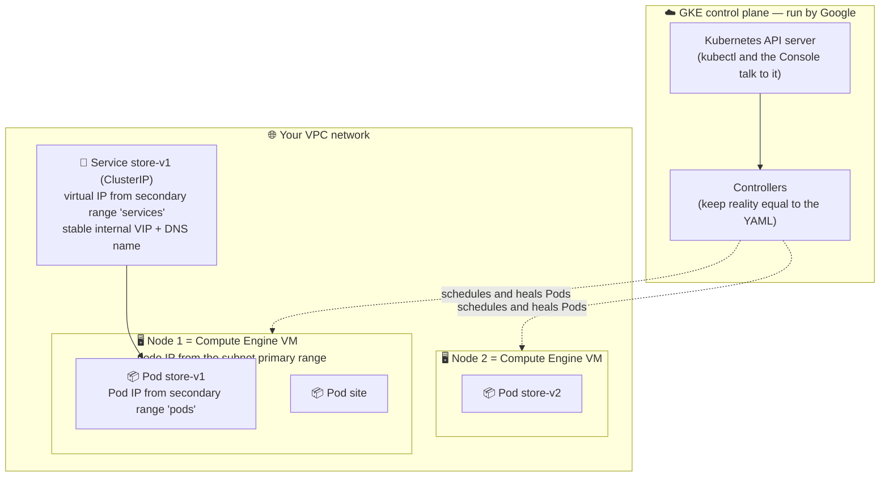

In the lab we use one subnet with three ranges:

| Range | CIDR in this lab | Used for |
| :--- | :--- | :--- |
| Primary range of `gke-gw-study-subnet` | `10.20.0.0/24` | Node IPs (and internal load balancer IPs) |
| Secondary range `gke-gw-study-pods` | `10.21.0.0/17` | Pod IPs |
| Secondary range `gke-gw-study-services` | `10.22.0.0/22` | Service ClusterIPs (virtual, cluster-internal) |
| Proxy-only subnet `gke-gw-study-proxy-only-subnet` | `10.20.2.0/23` | Envoy proxies of **regional** Application Load Balancers (needed by regional/internal Gateways) |

### 1.3 The one idea that explains everything: desired state + controllers

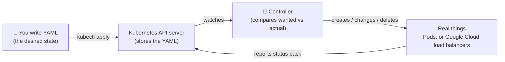

> [!IMPORTANT]
> On GKE, some controllers create **Google Cloud resources** for you.
> A `Service` of type `LoadBalancer`, an `Ingress` and a `Gateway` are **just YAML**.
> A Google-managed controller reads that YAML and builds a **real Cloud Load Balancer** (forwarding rule, proxy, URL map, backend service, health check, firewall rules…).
> You never click "Create load balancer" yourself — and you should not edit those generated resources by hand, because the controller will change them back.

---

## Part 2 — The question: how does outside traffic reach my Pods?

Pods have IP addresses, but you cannot simply give those IPs to your users:

- Pods are **temporary**. When a Pod is replaced, it gets a **new IP**.
- There are **many** Pods, and you want traffic **spread** across the healthy ones.
- You often want **one name / one IP** for many apps, plus **TLS**, **security** and **smart routing**.

So you need a **stable front door** that load balances to healthy Pods. On GKE there are **three main doors**, and all three create Google Cloud Load Balancing for you:

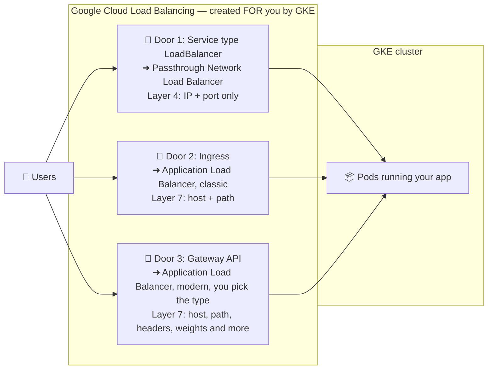

| Door | Kubernetes object | OSI layer | Google Cloud load balancer you get (external case) |
| :--- | :--- | :--- | :--- |
| 1 | `Service` with `type: LoadBalancer` | **L4** (TCP/UDP) | Regional **external passthrough Network Load Balancer** |
| 2 | `Ingress` (GKE Ingress controller) | **L7** (HTTP/HTTPS) | Global external **classic** Application Load Balancer (scheme `EXTERNAL`) |
| 3 | `Gateway` + `HTTPRoute` (GKE Gateway controller) | **L7** (HTTP/HTTPS) | You choose with `gatewayClassName` — e.g. **global external Application Load Balancer** (scheme `EXTERNAL_MANAGED`), regional external, regional internal… |

The next three parts look at each door. In the lab, you deploy **the same app behind all three doors** and compare what Google Cloud builds ([Lab 1](./hands-on-lab.md#lab-1--one-app-three-doors)).

---

## Part 3 — Door 1: Service type LoadBalancer (Layer 4)

### 3.1 What it is

A Service of type `LoadBalancer` says to GKE: *"give this Service an IP address that people outside the cluster can reach."*
It works at **Layer 4**: it only looks at **IP address, protocol and port**. It does not understand HTTP.

```yaml
# manifests/lab1-three-doors/02-door1-service-loadbalancer.yaml
apiVersion: v1
kind: Service
metadata:
  name: hello-lb
  namespace: lab1-three-doors
spec:
  type: LoadBalancer        # <- this one line asks GKE for a load balancer
  selector:
    app: hello              # <- send traffic to Pods with this label
  ports:
  - protocol: TCP
    port: 80                # <- port on the load balancer IP
    targetPort: 8080        # <- port of the container
```

### 3.2 What GKE builds in Google Cloud

GKE builds a **regional external passthrough Network Load Balancer**:

- **1 forwarding rule** with **its own public IP** (one IP **per Service**).
- **Backends = the cluster nodes** (VMs), not the Pods. A health check decides which nodes can receive traffic.
- GKE also creates the **firewall rules** for client traffic and health checks.
- *Version note:* newer GKE versions build a **backend service-based** NLB with `GCE_VM_IP` NEG backends (the default from GKE 1.37; you can opt in from GKE 1.33.1 with `spec.loadBalancerClass: networking.gke.io/l4-regional-external`). Older/default setups on earlier versions use a **target pool**. Either way, the load balancer sends packets **to nodes**.

### 3.3 How a packet flows

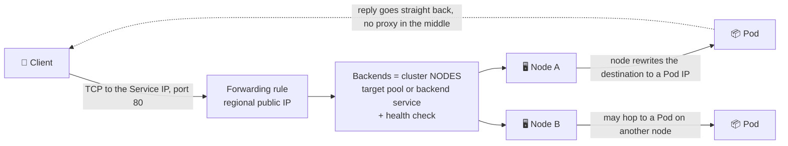

"**Passthrough**" means there is **no proxy**: the packet arrives at the node with the load balancer IP still as the destination. On the node, Kubernetes networking (kube-proxy or GKE Dataplane V2) forwards it to a Pod. The reply goes straight back to the client (direct server return).

### 3.4 Good for / not good for

| 👍 Good for | 👎 Not good for |
| :--- | :--- |
| **Any TCP/UDP protocol** (DNS, MQTT, databases, game servers, SMTP, custom protocols) | **HTTP smart routing** — no host/path/header rules, no redirects, no rewrites |
| Keeping the **original client IP** at packet level | **Sharing one IP** across many apps — each Service gets its own IP and its own load balancer |
| End-to-end TLS handled by the app itself | **TLS termination**, **Cloud Armor WAF**, **IAP**, **CDN** — those need an Application Load Balancer |
| Very simple setup, very low overhead | **Canary releases by percentage** — you can only change the ratio of Pods |

> [!TIP]
> Need an **internal** L4 load balancer (only reachable inside the VPC)? Add the annotation
> `networking.gke.io/load-balancer-type: "Internal"` to the Service. GKE then builds an **internal passthrough Network Load Balancer** with a private IP from the node subnet.

---

## Part 4 — Door 2: Ingress (Layer 7, the older way)

### 4.1 What it is

An **Ingress** is one Kubernetes object that holds **HTTP(S) routing rules**: *"for host X and path Y, send traffic to Service Z."*
On GKE, the built-in **GKE Ingress controller** reads it and builds an **Application Load Balancer** (a Layer 7 proxy).

```yaml
# manifests/lab1-three-doors/03-door2-ingress.yaml
apiVersion: networking.k8s.io/v1
kind: Ingress
metadata:
  name: hello-ingress
  namespace: lab1-three-doors
  annotations:
    kubernetes.io/ingress.class: "gce"   # gce = external, gce-internal = internal
spec:
  rules:
  - http:
      paths:
      - path: /
        pathType: Prefix
        backend:
          service:
            name: hello-svc               # a normal ClusterIP Service
            port:
              number: 80
```

> [!NOTE]
> When you apply this, `kubectl` prints:
> `Warning: annotation "kubernetes.io/ingress.class" is deprecated, please use 'spec.ingressClassName' instead`.
> This is expected. The **GKE Ingress controller still uses the annotation**, so keep it.

### 4.2 What GKE builds in Google Cloud

| Ingress class | Google Cloud load balancer |
| :--- | :--- |
| `gce` (default) | Global external **classic** Application Load Balancer (load balancing scheme `EXTERNAL`) |
| `gce-internal` | **Regional internal** Application Load Balancer (needs a proxy-only subnet) |

The pieces are the classic Application Load Balancer building blocks you already know:

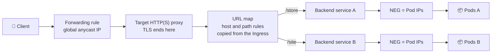

With **container-native load balancing** (NEGs, the default on VPC-native clusters), the load balancer sends traffic **straight to Pod IPs** — no extra hop through a node.

Extra Google Cloud features are added with **annotations** and two **GKE-only CRDs**:

| Want this… | …with GKE Ingress you use |
| :--- | :--- |
| Static IP, pre-shared certificate, Google-managed certificate | Annotations on the Ingress (`kubernetes.io/ingress.global-static-ip-name`, `ingress.gcp.kubernetes.io/pre-shared-cert`, `networking.gke.io/managed-certificates`) |
| Cloud Armor, IAP, Cloud CDN, timeouts, custom health check, session affinity | A **`BackendConfig`** object, linked to the **Service** with the annotation `cloud.google.com/backend-config` |
| HTTP → HTTPS redirect, SSL policy | A **`FrontendConfig`** object, linked to the **Ingress** with an annotation |

### 4.3 Why people outgrew Ingress

1. **One object, many owners.** The load balancer settings (IP, TLS, type) and the routing rules of **every app** live in the **same object**. Either the platform team becomes a bottleneck, or app teams get too much power.

   ```mermaid
   flowchart TB
       subgraph ING["ONE Ingress object, in ONE namespace"]
           I1["Load balancer type and IP<br/>(annotations)"]
           I2["TLS certificates"]
           I3["Routing rules for ALL apps"]
           I4["Extra features<br/>(more annotations, BackendConfig, FrontendConfig)"]
       end
       PT["🧑‍💼 Platform team"] -->|"owns"| I1
       PT -->|"owns"| I2
       AT["👩‍💻 App team A"] -->|"edits"| I3
       BT["👨‍💻 App team B"] -->|"edits"| I3
       AT -->|"edits"| I4
   ```

2. **Annotation sprawl.** Many features are free-text annotations: no schema, no validation, different for every vendor, not portable.
3. **The standard API is very small.** Only host + path matching. No header matching, no traffic weights, no redirects or rewrites in the API itself.
4. **Same-namespace only.** An Ingress can only send traffic to Services in **its own namespace**.
5. **The upstream API is frozen.** The Kubernetes project says Ingress gets **no new features**; new work goes into the Gateway API. The popular community **ingress-nginx** controller was **retired in March 2026**.
6. **On GKE, external Ingress = classic Application Load Balancer.** It does not create the newer **global external Application Load Balancer** (`EXTERNAL_MANAGED`) with its advanced traffic management. Gateway does.

> [!NOTE]
> **GKE Ingress is still a supported GKE feature** — your existing Ingresses keep working.
> The ingress-nginx retirement is about the *community NGINX controller*, not GKE Ingress.
> But new Google Cloud load balancing features arrive in **GKE Gateway**, so new projects should start there.

---

## Part 5 — Door 3: Gateway API and GKE Gateway (Layer 7, the modern way)

### 5.1 Gateway API vs GKE Gateway — two names, two meanings

| Name | What it is |
| :--- | :--- |
| **Gateway API** | An **open standard** from the Kubernetes project (SIG-Network). It is the official successor of Ingress. It became GA (`v1.0`) in October 2023. Many products implement it (GKE, Istio, Envoy Gateway, Cilium, NGINX Gateway Fabric, …). |
| **GKE Gateway controller** ("GKE Gateway") | **Google's implementation** of the Gateway API. It turns Gateway API objects into **Google Cloud Load Balancing** resources. Google runs and upgrades it for you: **no Pods on your nodes, nothing to install**, and no extra charge for the controller itself (you pay for the load balancer, as usual). |

A simple way to remember it: the **Gateway API is the language**, and **GKE Gateway is Google's "translator"** that turns that language into real Cloud Load Balancers.

### 5.2 The building blocks

| Object | The question it answers | Usually owned by | Google Cloud equivalent |
| :--- | :--- | :--- | :--- |
| **GatewayClass** | *What kind of load balancer?* (a template) | Google (pre-installed by GKE) | The load balancer **type** you would pick in the "Create load balancer" wizard |
| **Gateway** | *Give me a front door*: IP, ports, protocols, certificates — and **who is allowed to use it** | Platform / network team | **Forwarding rule + target proxy** (+ IP address, certificates) |
| **HTTPRoute** | *For host X / path Y / header Z, send traffic to Service S* (with weights, redirects, header changes…) | App team | **URL map** rules (host rules, path matchers, route rules) |
| **Service** | *Which Pods?* | App team | **Backend service + NEGs** (Pod IPs) |
| **Policies** (`HealthCheckPolicy`, `GCPBackendPolicy`, `GCPGatewayPolicy`, …) | *Add Google Cloud features* (health check, Cloud Armor, IAP, logging, SSL policy…) | Platform or app team | Health check, backend service settings, frontend settings |
| **ReferenceGrant** | *I allow objects from namespace A to point at my objects in namespace B* | Owner of the target namespace | No LB equivalent — a Kubernetes "handshake" for safe cross-namespace references |

### 5.3 Who owns what — the role-oriented design

This is the **biggest idea** of the Gateway API. Each team owns only its own piece, in its own namespace:

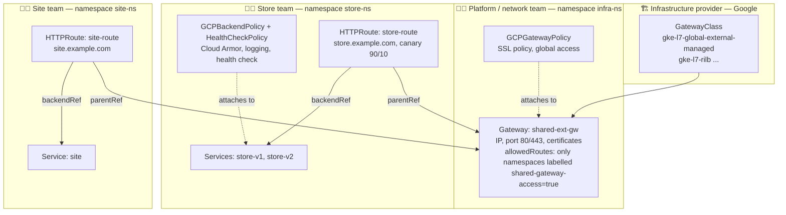

What this gives you:

- The **platform team** controls the expensive and risky parts: the IP, TLS certificates, the load balancer type, and **which namespaces may attach routes** (`allowedRoutes`).
- **App teams** self-serve their own routing (`HTTPRoute`) **without** touching the shared Gateway, and without being able to hijack another team's traffic.
- Many teams share **one Gateway = one load balancer = one IP**.
- If a team that is not allowed tries to attach a route, the Gateway **rejects** it and says why in the route status (`Accepted: False`, reason `NotAllowedByListeners`). You try this in [Lab 2](./hands-on-lab.md#lab-2--one-shared-gateway-many-teams).

### 5.4 The "aha" table: Gateway API objects ➜ Cloud Load Balancing components

If you know Cloud Load Balancing, you already know GKE Gateway. Here is the translation for `gke-l7-global-external-managed`:

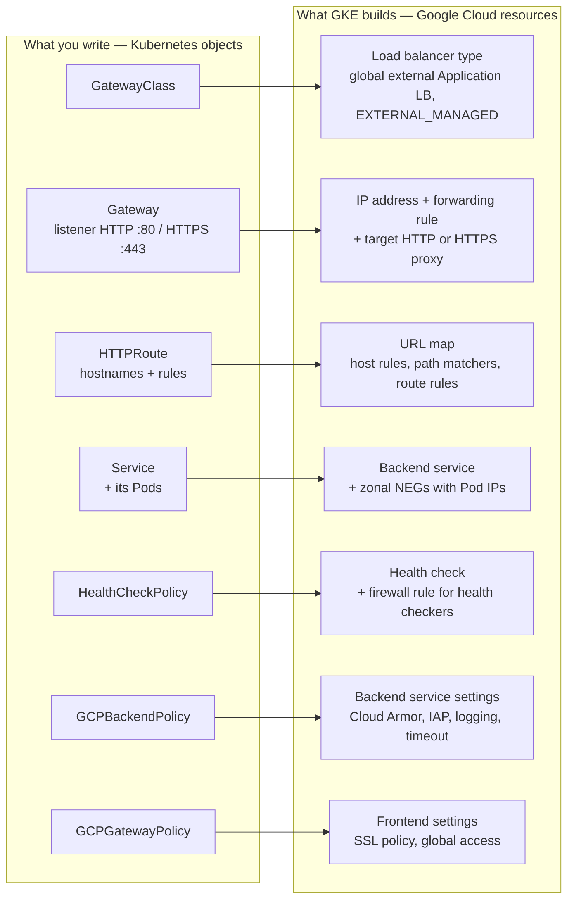

| You write… | GKE creates… | Where to see it in the Console |
| :--- | :--- | :--- |
| `Gateway` | IP address, forwarding rule(s), target HTTP(S) proxy, SSL certificates | **Network Services → Load balancing → Frontends** |
| `HTTPRoute` | Host rules, path matchers and route rules **inside one URL map** (all routes of a Gateway share that URL map) | Load balancer details → **Routing rules** |
| `Service` used in a route | Backend service + one NEG per zone (Pod IP:port endpoints) | **Backends** tab; **Compute Engine → Network endpoint groups** |
| `HealthCheckPolicy` | Health check settings | **Compute Engine → Health checks** |
| `GCPBackendPolicy` | Backend service settings (Cloud Armor policy, IAP, logging, timeout…) | Backend service details; **Network Security → Cloud Armor policies → Targets** |
| `GCPGatewayPolicy` | SSL policy on the target HTTPS proxy, global access on the forwarding rule | Frontend details |

> [!TIP]
> In **Kubernetes Engine → Gateways, Services & Ingress → Gateways**, open a Gateway: the **Details** page has a **Load balancer** link that jumps straight to the generated load balancer. Generated resource names usually start with `gkegw1-` (Gateway) — compare with `k8s2-` for Ingress.

### 5.5 What happens when you apply a Gateway and an HTTPRoute

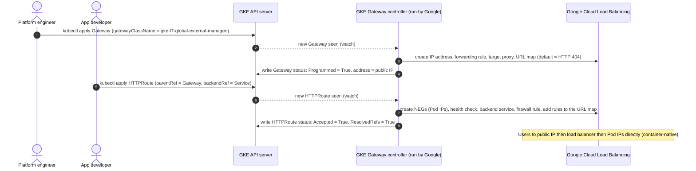

Things to notice:

- Everything is **asynchronous**. `kubectl apply` returns at once; the load balancer is ready a few minutes later.
- The controller **writes back status**. `kubectl get gateway` shows the IP and `PROGRAMMED=True`; `kubectl describe httproute` shows if the route was accepted — and if not, **why**. This is much easier to troubleshoot than Ingress annotations.
- A Gateway with **no routes** already has an IP. It answers **HTTP 404** until a route matches.

### 5.6 GatewayClasses on GKE — pick your load balancer

`gatewayClassName` is how you choose the load balancer product. This is the real list from the lab cluster (GKE `1.36.4-gke.2377000`, Autopilot, `asia-southeast2`):

```text
$ kubectl get gatewayclass
NAME                                            CONTROLLER                                   ACCEPTED   AGE
gke-l7-global-external-managed                  networking.gke.io/gateway                    True       10s
gke-l7-gxlb                                     networking.gke.io/gateway                    True       10s
gke-l7-regional-external-managed                networking.gke.io/gateway                    True       10s
gke-l7-rilb                                     networking.gke.io/gateway                    True       10s
gke-passthrough-lb-external-managed             networking.gke.io/persistent-ip-controller   True       31s
gke-passthrough-lb-internal-managed             networking.gke.io/persistent-ip-controller   True       31s
gke-persistent-fast-regional-external-managed   networking.gke.io/persistent-ip-controller   True       30s
gke-persistent-fast-regional-internal-managed   networking.gke.io/persistent-ip-controller   True       30s
gke-persistent-regional-external-managed        networking.gke.io/persistent-ip-controller   True       32s
gke-persistent-regional-internal-managed        networking.gke.io/persistent-ip-controller   True       31s
```

The four `gke-l7-*` classes (controller `networking.gke.io/gateway`) are the ones this study is about:

| GatewayClass | Google Cloud load balancer | Scheme | Scope | Proxy-only subnet? | Notes |
| :--- | :--- | :--- | :--- | :--- | :--- |
| `gke-l7-global-external-managed` | **Global external Application LB** | `EXTERNAL_MANAGED` | Global (anycast IP, Google edge) | No | ⭐ Default choice for internet-facing apps. Full advanced traffic management. |
| `gke-l7-regional-external-managed` | Regional external Application LB | `EXTERNAL_MANAGED` | One region | **Yes** | Keep traffic and TLS termination in one region (e.g. data residency); also works with the Standard network tier. |
| `gke-l7-rilb` | Regional **internal** Application LB | `INTERNAL_MANAGED` | One region (VPC-internal IP) | **Yes** | Apps for clients inside the VPC / on-prem. Global access via `GCPGatewayPolicy`. |
| `gke-l7-gxlb` | Global external **classic** Application LB | `EXTERNAL` | Global | No | Legacy. Basic host/path routing only — no weights, redirects, rewrites or header changes. Same LB type as GKE Ingress. |

- The `persistent-ip-controller` classes are special-purpose (for features such as persistent IP addresses for Pods). They are **not** general HTTP load balancers and are out of scope here.
- **Multi-cluster** versions end in `-mc` (for example `gke-l7-global-external-managed-mc`). They appear only when you enable multi-cluster Gateways on a fleet (see [5.10](#510-multi-cluster-gateways)).
- **Autopilot** clusters have the Gateway API turned on by default. On **Standard** clusters, tick **Enable Gateway API** (Networking section) or use `--gateway-api=standard`.

Which class should I pick?

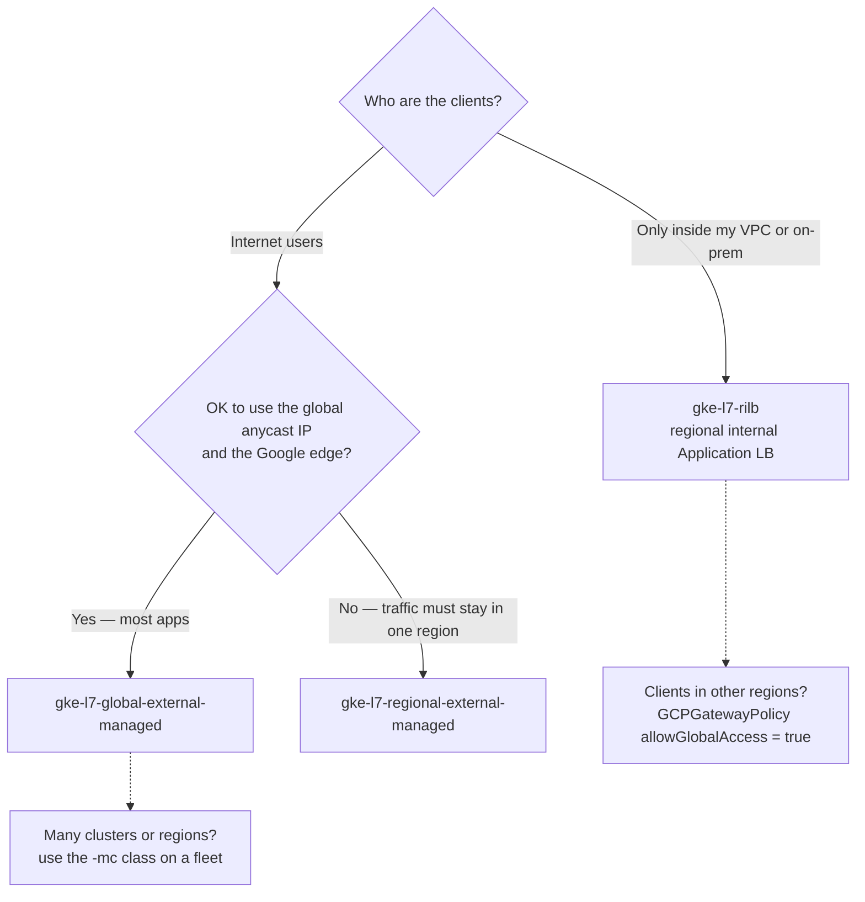

### 5.7 Routing features — what an HTTPRoute can do

**Host + path routing** (many apps behind one IP):

```yaml
spec:
  hostnames: ["store.example.com"]
  rules:
  - matches:
    - path: { type: PathPrefix, value: /cart }
    backendRefs:
    - { name: cart, port: 8080 }
```

**Header-based routing** (send testers to the new version):

```yaml
  - matches:
    - headers:
      - { name: env, value: canary }
    backendRefs:
    - { name: store-v2, port: 8080 }
```

**Weighted traffic split** (canary / blue-green — no extra Pods needed):

```yaml
  - backendRefs:
    - { name: store-v1, port: 8080, weight: 90 }
    - { name: store-v2, port: 8080, weight: 10 }
```

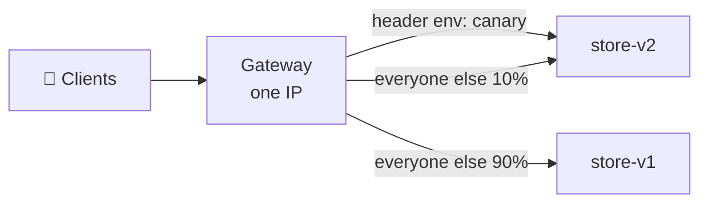

> [!TIP]
> With plain Kubernetes, a 90/10 canary means running 9 Pods of v1 for every 1 Pod of v2.
> With Gateway weights, the **load balancer** does the split, so you can run **1 Pod of each** and still get 90/10.

**Change headers, redirect, rewrite** (no app code needed):

```yaml
    filters:
    - type: RequestHeaderModifier          # header for the app
      requestHeaderModifier:
        add: [{ name: x-gateway-study, value: added-by-gke-gateway }]
    - type: ResponseHeaderModifier         # header for the client
      responseHeaderModifier:
        add: [{ name: x-route-rule, value: store-weighted-split-90-10 }]
---
    filters:
    - type: RequestRedirect                # old URL -> new URL (HTTP 301)
      requestRedirect:
        path: { type: ReplacePrefixMatch, replacePrefixMatch: /blog }
        statusCode: 301
---
    filters:
    - type: URLRewrite                     # /api/v1/x is sent to the app as /x
      urlRewrite:
        path: { type: ReplacePrefixMatch, replacePrefixMatch: / }
```

How rules are chosen when several match: the **more specific** rule wins — exact path beats prefix, a longer prefix beats a shorter one, and a rule with **more header matches** beats one with fewer. That is why the `env: canary` rule in the lab wins over the 90/10 rule.

| Capability | Managed classes (`gke-l7-global-external-managed`, `gke-l7-regional-external-managed`, `gke-l7-rilb`) | Classic `gke-l7-gxlb` |
| :--- | :--- | :--- |
| Host and path matching | ✅ | ✅ |
| Header / query parameter / method matching | ✅ | ❌ (basic host/path only) |
| Weighted traffic splitting | ✅ | ❌ |
| Request / response header modification | ✅ | ❌ |
| Redirects (incl. HTTP → HTTPS) and URL rewrites | ✅ | ❌ |

Always check the official [GatewayClass capabilities](https://cloud.google.com/kubernetes-engine/docs/how-to/gatewayclass-capabilities) page for the exact, current matrix. One more limit to know: one `HTTPRoute` can hold **at most 16 rules** (split big configs into several routes).

### 5.8 Policies — how Google Cloud features are attached (no more annotations)

Gateway API keeps the standard objects portable. Cloud-specific features are added with **separate, typed policy objects** that point at a target with `targetRef`. Kubernetes validates them, and their **status** tells you if they were attached.

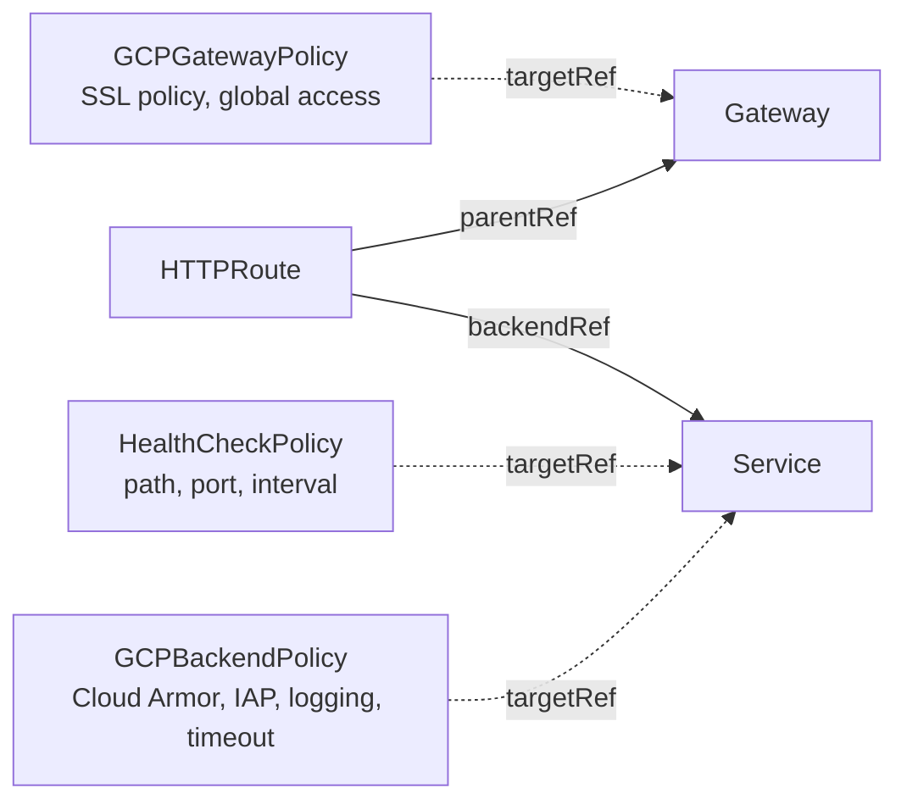

| Policy (`networking.gke.io/v1`) | Attaches to | Controls |
| :--- | :--- | :--- |
| `HealthCheckPolicy` | Service | Health check: type, request path, port, interval, timeout, thresholds, logging |
| `GCPBackendPolicy` | Service | Backend service: **Cloud Armor** (`securityPolicy`), **IAP**, request **logging** + sample rate, `timeoutSec`, connection draining, session affinity, max rate per endpoint |
| `GCPGatewayPolicy` | Gateway | Frontend: **SSL policy** (TLS versions/ciphers), **allowGlobalAccess** for internal Gateways |
| `GCPHTTPFilter` | An HTTPRoute rule (`ExtensionRef` filter) | URL-map-level features such as **Cloud CDN** caching |
| `GCPTrafficDistributionPolicy` | Service | Advanced load-balancing / traffic distribution settings |
| `GCPRoutingExtension`, `GCPTrafficExtension` | Gateway | **Service Extensions** — plug your own code (callouts) into the load balancer request path |

Example from the lab — Cloud Armor + logging + timeout for one Service:

```yaml
apiVersion: networking.gke.io/v1
kind: GCPBackendPolicy
metadata:
  name: store-v1-backend-policy
  namespace: store-ns            # same namespace as the Service
spec:
  default:
    securityPolicy: gke-gw-study-armor   # existing Cloud Armor policy
    timeoutSec: 30
    logging:
      enabled: true
      sampleRate: 1000000                # 1,000,000 = 100%
  targetRef:
    group: ""
    kind: Service
    name: store-v1
```

> [!WARNING]
> Attach backend policies to **every** Service a route can send traffic to. In the lab, if only `store-v1` had Cloud Armor, the 10% canary traffic to `store-v2` would **bypass** it.
> Also: do **not** use the Ingress `BackendConfig` on Services behind a Gateway — use `GCPBackendPolicy` and `HealthCheckPolicy` instead.

<details>
<summary>All Gateway-related CRDs that GKE installed in the lab cluster (click to expand)</summary>

```text
# Gateway API (upstream standard)
gatewayclasses.gateway.networking.k8s.io
gateways.gateway.networking.k8s.io
httproutes.gateway.networking.k8s.io
referencegrants.gateway.networking.k8s.io
tlsroutes.gateway.networking.k8s.io
backendtlspolicies.gateway.networking.k8s.io

# GKE-specific (networking.gke.io) - Gateway policies and extensions
gcpbackendpolicies.networking.gke.io
gcpgatewaypolicies.networking.gke.io
healthcheckpolicies.networking.gke.io
gcphttpfilters.networking.gke.io
gcptrafficdistributionpolicies.networking.gke.io
gcproutingextensions.networking.gke.io
gcptrafficextensions.networking.gke.io
gcpwasmplugins.networking.gke.io
gcpauthzextensions.networking.gke.io
gcpauthzpolicies.networking.gke.io
gcpedgeextensions.networking.gke.io
gcpagentgateways.networking.gke.io
gcpinferencepoolimports.networking.gke.io
lbpolicies.networking.gke.io

# Ingress-era CRDs (still there for GKE Ingress)
backendconfigs.cloud.google.com
frontendconfigs.networking.gke.io
managedcertificates.networking.gke.io
```

Source: [`logs/lab0-cluster-gatewayclasses.txt`](./logs/lab0-cluster-gatewayclasses.txt).
</details>

### 5.9 TLS and certificates

| Option | How | Best for |
| :--- | :--- | :--- |
| **Certificate Manager** (Google-managed or self-managed certs, wildcard, many certs) | Annotation on the Gateway: `networking.gke.io/certmap: <certificate-map-name>` | Production, many domains, automatic renewal |
| **Kubernetes Secret** | Listener `tls.certificateRefs` → a `kubernetes.io/tls` Secret | Quick tests, certificates managed by tools such as cert-manager |
| **Pre-shared Compute Engine SSL certificate** | Listener `tls.options: { networking.gke.io/pre-shared-certs: <cert-name> }` | Reusing certificates that already exist in the project |

HTTP → HTTPS redirect = an HTTP listener **plus** a small route that only redirects:

```yaml
apiVersion: gateway.networking.k8s.io/v1
kind: Gateway
metadata:
  name: external-https-gw
  namespace: infra-ns
  annotations:
    networking.gke.io/certmap: store-example-com-map   # Certificate Manager map
spec:
  gatewayClassName: gke-l7-global-external-managed
  listeners:
  - name: http
    protocol: HTTP
    port: 80
  - name: https
    protocol: HTTPS
    port: 443
---
apiVersion: gateway.networking.k8s.io/v1
kind: HTTPRoute
metadata:
  name: http-to-https-redirect
  namespace: infra-ns
spec:
  parentRefs:
  - name: external-https-gw
    sectionName: http            # attach ONLY to the port 80 listener
  rules:
  - filters:
    - type: RequestRedirect
      requestRedirect:
        scheme: https
        statusCode: 301
```

### 5.10 Multi-cluster Gateways

When the same app runs in **several clusters** (for example two regions), one multi-cluster Gateway can front all of them:

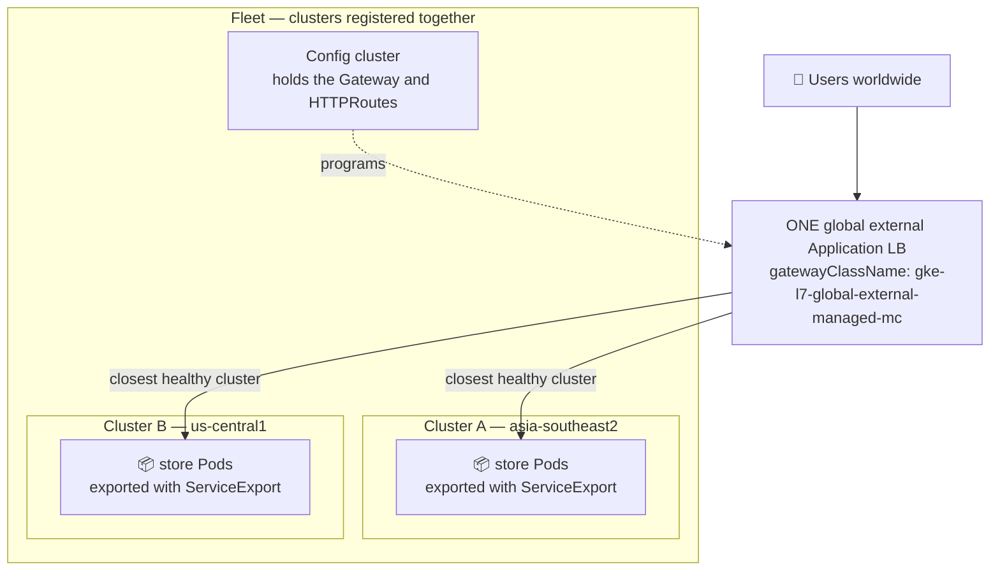

- Same API, just a `-mc` GatewayClass and `ServiceImport` backends instead of `Service`.
- Use cases: multi-region high availability, cluster blue/green upgrades, moving traffic between clusters with weights.
- It is the Gateway-based successor of the older **Multi Cluster Ingress**. Multi-cluster features can have **extra pricing** — check the pricing page before you use them.

### 5.11 New things are being built on top of Gateway

Because the Gateway API is the future of Kubernetes networking, new GKE networking features are built on it:

- **GKE Inference Gateway** — routes requests to AI/LLM model servers using model-aware and load-aware signals (`InferencePool`), instead of simple round robin.
- **Service Extensions** — run your own logic in the load balancer path (`GCPRoutingExtension`, `GCPTrafficExtension`, Wasm plugins).
- **Cloud CDN, IAP, Cloud Armor, SSL policies** — all as typed policies/filters, not annotations.

---

## Part 6 — Side-by-side comparison

### 6.1 The big table

| | 🚪 Service type `LoadBalancer` | 🚪 GKE Ingress | 🚪 GKE Gateway |
| :--- | :--- | :--- | :--- |
| **Layer** | L4 (TCP/UDP) | L7 (HTTP/HTTPS) | L7 (HTTP/HTTPS) |
| **Kubernetes API** | Core `v1` Service | `networking.k8s.io/v1` Ingress — **frozen** upstream | `gateway.networking.k8s.io/v1` — **actively developed** |
| **Google Cloud LB (external)** | Regional external **passthrough Network LB** | Global external **classic** Application LB (`EXTERNAL`) | **You choose**: global external Application LB (`EXTERNAL_MANAGED`), regional external, regional internal, classic |
| **Google Cloud LB (internal)** | Internal passthrough Network LB (annotation) | Regional internal Application LB (`gce-internal`) | Regional internal Application LB (`gke-l7-rilb`), multi-cluster options |
| **IP addresses** | **One per Service** | One per Ingress | **One per Gateway, shared** by many routes, teams and namespaces |
| **Routing** | None (IP + port only) | Host + path | Host, path, **header, query, method**; **weights**; **redirects**; **rewrites**; **header changes** |
| **Canary by percentage** | ❌ (only by Pod ratio) | ❌ | ✅ `weight` |
| **TLS termination at the LB** | ❌ (passthrough) | ✅ | ✅ (Certificate Manager, Secrets, pre-shared certs) |
| **Cloud Armor WAF / IAP** | ❌ | ✅ via `BackendConfig` | ✅ via `GCPBackendPolicy` |
| **How cloud features are configured** | Annotations | Annotations + `BackendConfig` / `FrontendConfig` | **Typed policy objects** with status |
| **Role separation (platform vs app teams)** | ❌ | ❌ (one object) | ✅ GatewayClass / Gateway / Route |
| **Cross-namespace** | n/a | ❌ (same namespace only) | ✅ `allowedRoutes` + `ReferenceGrant` |
| **Multi-cluster** | ❌ | Multi Cluster Ingress (separate API) | Multi-cluster Gateway (**same API**, `-mc` classes) |
| **Client source IP seen by the app** | ✅ Original packet source IP | Via `X-Forwarded-For` header | Via `X-Forwarded-For` header |
| **Protocols** | Any TCP/UDP | HTTP, HTTPS, HTTP/2 | HTTP, HTTPS, HTTP/2 |
| **Best for** | Non-HTTP apps, simple L4 exposure | Existing HTTP apps already on Ingress | New HTTP(S) apps, shared platforms, canary, advanced routing, multi-cluster |

### 6.2 Same app, three YAMLs

Door 1 — **one** object:

```yaml
apiVersion: v1
kind: Service
metadata: { name: hello-lb, namespace: lab1-three-doors }
spec:
  type: LoadBalancer
  selector: { app: hello }
  ports: [{ port: 80, targetPort: 8080 }]
```

Door 2 — Ingress + a ClusterIP Service:

```yaml
apiVersion: networking.k8s.io/v1
kind: Ingress
metadata:
  name: hello-ingress
  namespace: lab1-three-doors
  annotations: { kubernetes.io/ingress.class: "gce" }
spec:
  rules:
  - http:
      paths:
      - path: /
        pathType: Prefix
        backend: { service: { name: hello-svc, port: { number: 80 } } }
```

Door 3 — Gateway (platform team) + HTTPRoute (app team) + the same ClusterIP Service:

```yaml
apiVersion: gateway.networking.k8s.io/v1
kind: Gateway
metadata: { name: hello-gateway, namespace: lab1-three-doors }
spec:
  gatewayClassName: gke-l7-global-external-managed
  listeners: [{ name: http, protocol: HTTP, port: 80 }]
---
apiVersion: gateway.networking.k8s.io/v1
kind: HTTPRoute
metadata: { name: hello-route, namespace: lab1-three-doors }
spec:
  parentRefs: [{ name: hello-gateway }]
  rules:
  - matches: [{ path: { type: PathPrefix, value: / } }]
    backendRefs: [{ name: hello-svc, port: 80 }]
```

Gateway has **more objects** for a single app — that is the price of the role separation. The pay-off comes as soon as you have **several apps or teams**: they all share one Gateway and each team only writes small HTTPRoutes.

---

## Part 7 — Why (and when) to choose GKE Gateway

### 7.1 Eight reasons to choose GKE Gateway

1. **One front door for many apps and teams.** One Gateway = one load balancer = one IP shared by many HTTPRoutes. Fewer load balancers, IPs, certificates and DNS records than "one LoadBalancer Service per app".
2. **Safe self-service.** The platform team owns the Gateway; app teams own their routes. `allowedRoutes` and `ReferenceGrant` stop teams from attaching where they should not, or hijacking another team's hostname.
3. **Rich routing in the standard itself.** Header/query/method matching, weighted splits, redirects, rewrites and header changes are **fields in the API**, not vendor annotations.
4. **The modern Google Cloud load balancers.** Gateway gives you the global external Application LB (`EXTERNAL_MANAGED`) with advanced traffic management, plus regional external and internal options. External GKE Ingress only gives you the **classic** Application LB.
5. **Typed policies and clear status.** Cloud Armor, IAP, health checks, logging, SSL policies are **validated objects**. Gateway, route and policy **status** tell you exactly what is wrong (e.g. `NotAllowedByListeners`).
6. **A portable standard.** The core objects (Gateway, HTTPRoute) are the same on any Gateway API implementation. Your skills and most of your YAML move with you.
7. **Future-proof.** The Ingress API is frozen, the community ingress-nginx controller was retired in March 2026, and new GKE features (Inference Gateway, Service Extensions, multi-cluster) are built on Gateway.
8. **Multi-cluster with the same model.** Grow from one cluster to many regions by switching to a `-mc` GatewayClass — no new API to learn.

### 7.2 When something else is the better choice

| Situation | Better choice | Why |
| :--- | :--- | :--- |
| The protocol is **not HTTP** (DNS, MQTT, databases, game servers, SMTP, custom TCP/UDP) | **Service type LoadBalancer** | GKE's managed GatewayClasses are Layer 7 HTTP(S) proxies |
| You need the **original client IP at packet level**, or no proxy in the path | **Service type LoadBalancer** | Passthrough keeps the packet as is |
| A single internal tool, quick test, one Service | Either (LoadBalancer is the simplest) | Gateway's benefits show with many apps/teams |
| A stable Ingress that uses a feature you have not yet validated on Gateway | **Keep Ingress for now**, plan the migration | Check feature parity first (see [Part 8](#part-8--moving-from-ingress-to-gateway)) |
| Service-to-service (east-west) traffic with mTLS inside the cluster | A **service mesh** (e.g. Cloud Service Mesh) | GKE Gateway is for traffic **into** the cluster through Cloud Load Balancing |

### 7.3 Decision helper

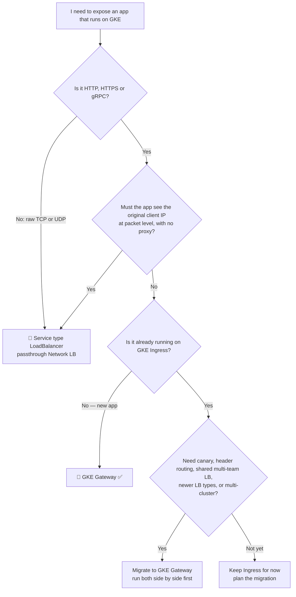

---

## Part 8 — Moving from Ingress to Gateway

### 8.1 Translation table

| GKE Ingress | GKE Gateway |
| :--- | :--- |
| `kubernetes.io/ingress.class: "gce"` | `gatewayClassName: gke-l7-global-external-managed` (or `gke-l7-gxlb` for an exact classic match) |
| `kubernetes.io/ingress.class: "gce-internal"` | `gatewayClassName: gke-l7-rilb` |
| `spec.rules[].host` / `paths` | `HTTPRoute` `hostnames` / `rules[].matches[].path` |
| `spec.tls` + Secret | Gateway listener `tls.certificateRefs` |
| `networking.gke.io/managed-certificates` (ManagedCertificate) | **Certificate Manager** map: Gateway annotation `networking.gke.io/certmap` |
| `ingress.gcp.kubernetes.io/pre-shared-cert` | Listener `tls.options: networking.gke.io/pre-shared-certs` |
| `kubernetes.io/ingress.global-static-ip-name` | Gateway `spec.addresses` with `type: NamedAddress` |
| `FrontendConfig` → `redirectToHttps` | An `HTTPRoute` with a `RequestRedirect` (`scheme: https`) on the HTTP listener |
| `FrontendConfig` → `sslPolicy` | `GCPGatewayPolicy` → `sslPolicy` |
| `BackendConfig` → `securityPolicy` (Cloud Armor), `iap`, `timeoutSec`, `connectionDraining`, `sessionAffinity`, `logging` | `GCPBackendPolicy` → same ideas |
| `BackendConfig` → `healthCheck` | `HealthCheckPolicy` |
| `BackendConfig` → `cdn` | `GCPHTTPFilter` referenced from the HTTPRoute (check current docs) |

### 8.2 A safe migration plan

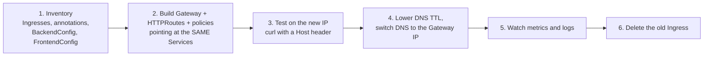

- Ingress and Gateway **can point at the same Services at the same time** (Lab 1 does exactly this), so you can test the new path with zero downtime.
- The Kubernetes SIG-Network tool [`ingress2gateway`](https://github.com/kubernetes-sigs/ingress2gateway) converts Ingress YAML into draft Gateway/HTTPRoute YAML. Always **review** the output, especially for vendor annotations.
- Read Google's guide: [Migrate Ingress to Gateway API](https://cloud.google.com/kubernetes-engine/docs/how-to/migrate-ingress-gateway).

---

## Part 9 — Troubleshooting cheat sheet

### 9.1 Commands

```bash
# Which load balancer types can I use?
kubectl get gatewayclass

# Is my Gateway ready? (look at ADDRESS and PROGRAMMED)
kubectl get gateway -A
kubectl describe gateway shared-ext-gw -n infra-ns      # Conditions + attached routes per listener

# Was my route accepted by the Gateway? Can it find its Services?
kubectl get httproute -A
kubectl describe httproute store-route -n store-ns      # Parents: Accepted / ResolvedRefs

# Were my policies attached?
kubectl get healthcheckpolicy,gcpbackendpolicy,gcpgatewaypolicy -A
kubectl describe gcpbackendpolicy store-v1-backend-policy -n store-ns

# Look at what GKE built in Google Cloud
gcloud compute url-maps list --filter="name~gkegw1" --project=PROJECT_ID
gcloud compute backend-services list --filter="name~gkegw1" --project=PROJECT_ID
```

### 9.2 Common problems

| Symptom | Likely cause | Fix |
| :--- | :--- | :--- |
| Gateway stays **Pending / "Waiting for controller"** | Wrong `gatewayClassName`, or Gateway API not enabled (Standard cluster) | `kubectl get gatewayclass`; enable Gateway API on the cluster |
| **Regional or internal** Gateway never gets an address | No **proxy-only subnet** (`REGIONAL_MANAGED_PROXY`, `ACTIVE`) in that region and VPC | Create the proxy-only subnet first |
| Route `Accepted: False`, reason **`NotAllowedByListeners`** | The route's namespace is not allowed by the listener's `allowedRoutes` | Add the namespace label, or change `allowedRoutes` |
| Route `ResolvedRefs: False`, reason **`RefNotPermitted`** | `backendRef` points to a Service in another namespace without a `ReferenceGrant` | Create a `ReferenceGrant` **in the Service's namespace** |
| Route `ResolvedRefs: False`, reason **`BackendNotFound`** | Service name/port typo | Fix the `backendRefs` |
| **HTTP 404** from the load balancer | No route matches the **Host** header or path | Check `hostnames`; test with `curl -H "Host: store.example.com" http://IP/` |
| **HTTP 502 / 503** | Backends unhealthy (wrong health check path/port), Pods not ready | Add a `HealthCheckPolicy`; check readiness probes and backend health in the Console |
| Change "does nothing" | Load balancer changes take **a few minutes** to spread | Wait 2–5 minutes, then test again |
| Cloud Armor policy does not apply to some traffic | Policy attached to only some Services | Attach `GCPBackendPolicy` to **every** backend Service of the route |

---

## Part 10 — Glossary

| Term | Meaning |
| :--- | :--- |
| **L4 / L7** | Layer 4 = IP + TCP/UDP port. Layer 7 = the application protocol (HTTP: host, path, headers). |
| **Passthrough LB** | The load balancer forwards packets without terminating the connection (no proxy). |
| **Proxy LB** | The load balancer ends the client connection and opens a new one to the backend (Application LBs, Envoy/GFE). |
| **`EXTERNAL` vs `EXTERNAL_MANAGED`** | Load balancing scheme of the **classic** vs the **newer** (Envoy-based) external Application LB. Advanced traffic management needs `EXTERNAL_MANAGED`. |
| **Proxy-only subnet** | A subnet (`REGIONAL_MANAGED_PROXY`) that Google uses for the Envoy proxies of **regional** Application LBs. One active per region per VPC. |
| **NEG** | Network Endpoint Group: a list of `IP:port` endpoints. With container-native load balancing these are **Pod IPs**. |
| **Container-native load balancing** | The load balancer sends traffic straight to Pods (NEGs) instead of to nodes. |
| **GatewayClass / Gateway / HTTPRoute** | LB type template / front door (IP, ports, certs) / routing rules. |
| **`parentRef` / `backendRef`** | "Attach this route to that Gateway" / "send traffic to that Service". |
| **`allowedRoutes`** | The Gateway listener setting that decides which namespaces may attach routes. |
| **`ReferenceGrant`** | Permission, created in the target namespace, that lets objects from another namespace reference it. |
| **Policy attachment** | Adding cloud features with separate objects that point at a Gateway or Service (`targetRef`). |
| **ClusterIP Service** | Stable, cluster-internal virtual IP + DNS name for a set of Pods. |
| **Autopilot** | GKE mode where Google manages the nodes; you pay per Pod resources. |

---

## References

**Google Cloud (GKE) documentation**

- [About the Gateway API (GKE)](https://cloud.google.com/kubernetes-engine/docs/concepts/gateway-api)
- [Deploying Gateways](https://cloud.google.com/kubernetes-engine/docs/how-to/deploying-gateways)
- [GatewayClass capabilities](https://cloud.google.com/kubernetes-engine/docs/how-to/gatewayclass-capabilities)
- [Configure Gateway resources using policies](https://cloud.google.com/kubernetes-engine/docs/how-to/configure-gateway-resources)
- [Gateway security (TLS, Cloud Armor, IAP)](https://cloud.google.com/kubernetes-engine/docs/how-to/secure-gateway)
- [Multi-cluster Gateways](https://cloud.google.com/kubernetes-engine/docs/concepts/multi-cluster-gateways)
- [Migrate Ingress to Gateway API](https://cloud.google.com/kubernetes-engine/docs/how-to/migrate-ingress-gateway)
- [GKE Ingress for Application Load Balancers](https://cloud.google.com/kubernetes-engine/docs/concepts/ingress)
- [LoadBalancer Services](https://cloud.google.com/kubernetes-engine/docs/concepts/service-load-balancer)
- [About GKE Inference Gateway](https://cloud.google.com/kubernetes-engine/docs/concepts/about-gke-inference-gateway)

**Kubernetes community**

- [Gateway API project](https://gateway-api.sigs.k8s.io/)
- [Kubernetes docs — Gateway API](https://kubernetes.io/docs/concepts/services-networking/gateway/)
- [Kubernetes docs — Ingress (note: the Ingress API is frozen)](https://kubernetes.io/docs/concepts/services-networking/ingress/)
- [Ingress NGINX retirement announcement (Kubernetes blog)](https://kubernetes.io/blog/2025/11/11/ingress-nginx-retirement/)
- [ingress2gateway](https://github.com/kubernetes-sigs/ingress2gateway)
